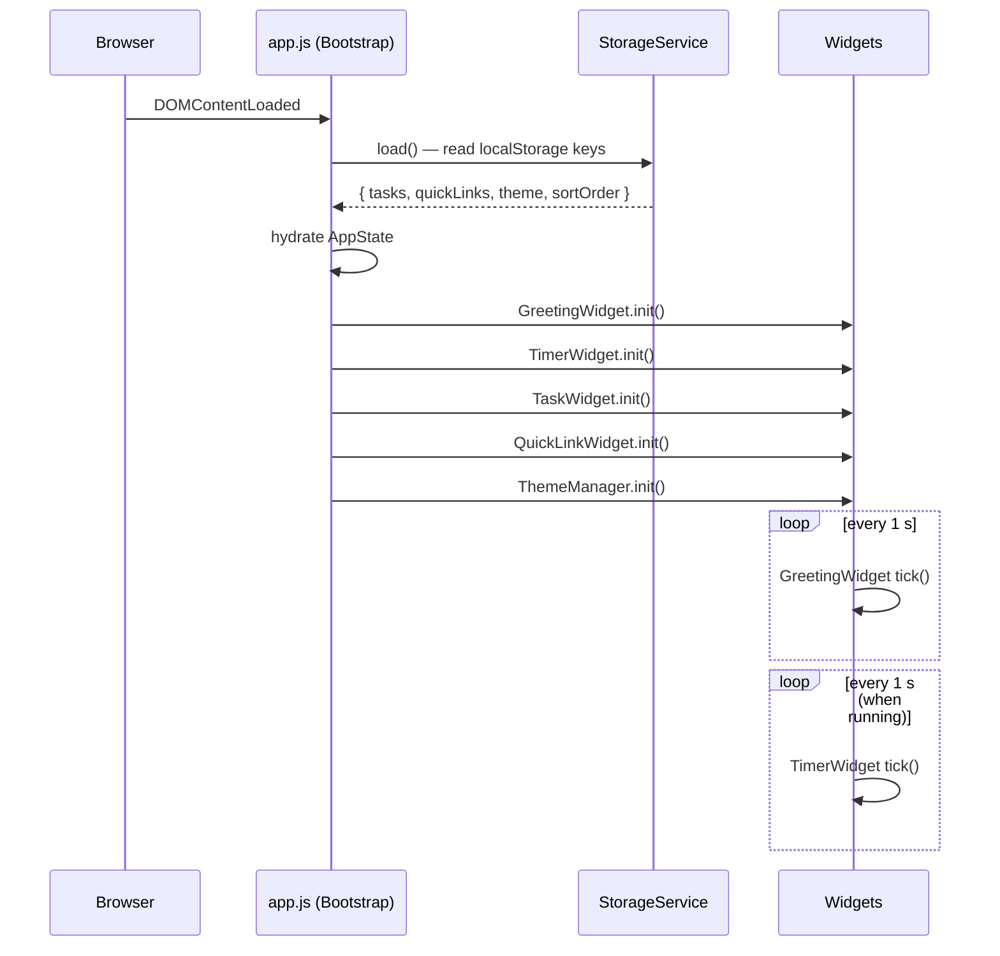

# Design Document: To-Do List Dashboard

## Overview

The To-Do List Dashboard is a fully client-side, single-page productivity application built with plain HTML, CSS, and Vanilla JavaScript — no frameworks, no build tooling, no backend. All state is held in memory while the page is open and persisted to `localStorage` as serialized JSON. The four widgets (Greeting, Focus Timer, To-Do List, Quick Links) share a single JS module (`js/app.js`) and a single stylesheet (`css/styles.css`).

The design prioritises:

- **Zero dependencies** — works as a standalone `index.html` opened from the filesystem or served statically.
- **Defensive storage access** — every `localStorage` read/write is wrapped in a `try/catch` so a quota error or Safari private-mode restriction never crashes the app.
- **Clear module boundaries** — each widget is an isolated section of `app.js` with its own initialisation function; they communicate only through the shared in-memory `AppState` object and a thin Storage service.

---

## Architecture

### File Structure

```
project-root/
├── index.html          # Single HTML page; all markup for all four widgets
├── css/
│   └── styles.css      # All styling: layout, light theme, dark theme override
└── js/
    └── app.js          # All behaviour: state, storage, widget modules, bootstrap
```

### Module Breakdown (logical sections of `app.js`)

```
app.js
├── StorageService          — safe read / write / clear wrappers around localStorage
├── AppState                — in-memory singleton; source of truth for runtime state
├── GreetingWidget          — clock interval, date formatter, greeting logic
├── TimerWidget             — countdown interval, start/stop/reset, button state
├── TaskWidget
│   ├── task CRUD           — add, edit, delete
│   ├── validation          — empty/whitespace, duplicate, length checks
│   ├── sort engine         — three sort strategies
│   └── render              — list re-render from AppState
├── QuickLinkWidget         — add, delete, open-in-tab, render
├── ThemeManager            — toggle, persist, apply-on-load
└── Bootstrap (DOMContentLoaded)
        — calls each widget's init() in order
        — calls StorageService.load() to hydrate AppState
        — handles global storage-unavailable banner
```

### Execution Flow



---

## Components and Interfaces

### GreetingWidget

| Method | Signature | Description |
|---|---|---|
| `init()` | `() → void` | Renders immediately, starts 1 s interval |
| `tick()` | `() → void` | Updates date, time, greeting DOM nodes |
| `getGreeting(hour)` | `(number) → string` | Pure function: maps hour → greeting string |
| `formatDate(date)` | `(Date) → string` | Returns "Weekday, Month D, YYYY" |
| `formatTime(date)` | `(Date) → string` | Returns "HH:MM:SS" (24-h, zero-padded) |

### TimerWidget

| Method | Signature | Description |
|---|---|---|
| `init()` | `() → void` | Sets display to 25:00, wires button listeners |
| `start()` | `() → void` | Validates not at 00:00, starts 1 s interval |
| `stop()` | `() → void` | Clears interval, freezes display |
| `reset()` | `() → void` | Clears interval, restores 25:00 |
| `tick()` | `() → void` | Decrements `remainingSeconds`, updates DOM, checks for 00:00 |
| `updateButtonStates()` | `() → void` | Enables/disables Start/Stop per widget state |
| `formatDisplay(s)` | `(number) → string` | Converts total seconds → "MM:SS" |

**Internal state** (not persisted):
- `remainingSeconds: number` — starts at 1500
- `intervalId: number | null` — `setInterval` handle

### TaskWidget

| Method | Signature | Description |
|---|---|---|
| `init()` | `() → void` | Renders from `AppState.tasks`, wires Add/sort listeners |
| `addTask(title)` | `(string) → Result` | Validates, creates Task, appends, persists, re-renders |
| `beginEdit(id)` | `(string) → void` | Swaps title span for input pre-populated with current title |
| `confirmEdit(id, newTitle)` | `(string, string) → Result` | Validates, updates task, persists, re-renders |
| `cancelEdit(id)` | `(string) → void` | Discards input, restores display view |
| `toggleComplete(id)` | `(string) → Result` | Flips `completed`, persists, re-renders |
| `deleteTask(id)` | `(string) → Result` | Removes from `AppState.tasks`, persists, re-renders |
| `sortTasks(strategy)` | `(SortStrategy) → Task[]` | Returns sorted copy; does not mutate storage |
| `render()` | `() → void` | Full list re-render from `AppState.tasks` applying current sort |
| `validate(title, excludeId?)` | `(string, string?) → ValidationResult` | Checks blank, duplicate, length |

### QuickLinkWidget

| Method | Signature | Description |
|---|---|---|
| `init()` | `() → void` | Renders from `AppState.quickLinks`, wires Add listener |
| `addLink(label, url)` | `(string, string) → Result` | Validates, creates QuickLink, persists, re-renders |
| `deleteLink(id)` | `(string) → void` | Removes, persists, re-renders |
| `render()` | `() → void` | Re-renders all link buttons |
| `validateLink(label, url)` | `(string, string) → ValidationResult` | Checks blank label/url, URL scheme, max count |

### ThemeManager

| Method | Signature | Description |
|---|---|---|
| `init()` | `() → void` | Reads stored theme (or defaults `light`), applies before paint |
| `toggle()` | `() → void` | Flips theme, persists, applies |
| `apply(theme)` | `(Theme) → void` | Sets `data-theme` attribute on `<html>` |

### StorageService

| Method | Signature | Description |
|---|---|---|
| `load()` | `() → StoragePayload` | Reads and JSON-parses all keys; on error returns safe defaults |
| `saveTasks(tasks)` | `(Task[]) → boolean` | Serialises and writes; returns `false` on QuotaExceededError |
| `saveQuickLinks(links)` | `(QuickLink[]) → boolean` | Same pattern |
| `saveTheme(theme)` | `(Theme) → boolean` | Same pattern |
| `saveSortOrder(order)` | `(SortStrategy) → boolean` | Same pattern |

---

## Data Models

### `Task`

```js
{
  id:        string,   // crypto.randomUUID() or Date.now().toString()
  title:     string,   // trimmed; 1–200 chars; unique case-insensitively
  completed: boolean,  // false on creation
  createdAt: number    // Date.now() timestamp (ms since epoch)
}
```

### `QuickLink`

```js
{
  id:    string,  // crypto.randomUUID()
  label: string,  // 1–50 chars
  url:   string   // 1–2048 chars; must start with http:// or https://
}
```

### `AppState` (in-memory singleton)

```js
{
  tasks:      Task[],       // ordered by insertion; sort is applied on render only
  quickLinks: QuickLink[],  // insertion-ordered
  theme:      'light' | 'dark',
  sortOrder:  'createdAsc' | 'createdDesc' | 'completionState'
}
```

### `localStorage` keys

| Key | Value type | Default |
|---|---|---|
| `tld_tasks` | `JSON string of Task[]` | `"[]"` |
| `tld_quicklinks` | `JSON string of QuickLink[]` | `"[]"` |
| `tld_theme` | `"light"` \| `"dark"` | `"light"` |
| `tld_sort` | `"createdAsc"` \| `"createdDesc"` \| `"completionState"` | `"createdAsc"` |

### `ValidationResult`

```js
{
  ok:      boolean,
  message: string | null  // null when ok === true
}
```

### `SortStrategy` enum (string union)

```js
type SortStrategy = 'createdAsc' | 'createdDesc' | 'completionState'
```

---

## Correctness Properties

*A property is a characteristic or behavior that should hold true across all valid executions of a system — essentially, a formal statement about what the system should do. Properties serve as the bridge between human-readable specifications and machine-verifiable correctness guarantees.*

### Property 1: Non-empty task addition grows the list and sets incomplete state

*For any* task list and any task title that is non-empty after trimming, does not duplicate an existing title (case-insensitively), and is at most 200 characters, calling `addTask(title)` SHALL result in `AppState.tasks` having exactly one more entry than before the call, and the new entry's `completed` field SHALL be `false`.

**Validates: Requirements 3.2, 3.7**

---

### Property 2: Whitespace-only and empty titles are always rejected

*For any* string composed entirely of whitespace characters (including the empty string), calling `validate(title)` (used by both `addTask` and `confirmEdit`) SHALL return a failed `ValidationResult` and leave `AppState.tasks` unchanged.

**Validates: Requirements 3.4, 4.5**

---

### Property 3: Duplicate task titles are always rejected (case-insensitive)

*For any* task list containing at least one task, and any title string whose trimmed lowercase form matches the trimmed lowercase form of any existing task's title, calling `validate(title)` SHALL return a failed `ValidationResult` and leave `AppState.tasks` unchanged.

**Validates: Requirements 3.5, 4.6**

---

### Property 4: Task serialisation round-trip through storage

*For any* array of `Task` objects, calling `StorageService.saveTasks(tasks)` followed by `StorageService.load()` SHALL produce a task array that is deeply equal to the original — same `id`, `title`, `completed`, and `createdAt` for every task, in the same order.

**Validates: Requirements 3.2, 6.1, 6.6, 9.2**

---

### Property 5: Task edit preserves identity, completion, and creation timestamp

*For any* task in the list and any valid new title (non-empty after trimming, non-duplicate, ≤200 chars), calling `confirmEdit(id, newTitle)` SHALL update only the `title` field of that task; the `id`, `completed`, and `createdAt` fields SHALL remain unchanged.

**Validates: Requirements 4.3**

---

### Property 6: Toggle completion is its own inverse

*For any* task, calling `toggleComplete(id)` twice in succession SHALL return the task's `completed` field to its original value.

**Validates: Requirements 5.2**

---

### Property 7: Delete removes exactly the targeted task

*For any* task list with at least one task, and any `id` present in that list, calling `deleteTask(id)` SHALL produce a task list that does not contain an entry with that `id`, and all other tasks SHALL remain present and unmodified.

**Validates: Requirements 5.6**

---

### Property 8: Sort is a non-mutating permutation

*For any* task list and any `SortStrategy`, calling `sortTasks(strategy)` SHALL return an array whose elements are a permutation of the original `AppState.tasks` (same set of `id` values, no additions or deletions), and `AppState.tasks` itself SHALL remain in its original insertion order afterwards.

**Validates: Requirements 6.3**

---

### Property 9: Greeting maps every hour of the day to exactly one greeting

*For any* integer hour in [0, 23], `getGreeting(hour)` SHALL return exactly one of `"Good Morning"`, `"Good Afternoon"`, `"Good Evening"`, or `"Good Night"` — the mapping SHALL be total and exhaustive across all 24 hours.

**Validates: Requirements 1.3, 1.4, 1.5, 1.6**

---

### Property 10: Timer display format is always valid MM:SS

*For any* integer `s` in [0, 1500], `formatDisplay(s)` SHALL return a string matching the regular expression `^[0-2][0-9]:[0-5][0-9]$` (two-digit minutes, colon separator, two-digit seconds, all within valid clock ranges).

**Validates: Requirements 2.3**

---

### Property 11: URL scheme validation is total over all strings

*For any* string that does not begin with `http://` or `https://`, `validateLink(label, url)` SHALL return a failed `ValidationResult` regardless of label content. *For any* URL that does begin with `http://` or `https://` paired with a non-empty, non-whitespace label of at most 50 characters, `validateLink` SHALL return a successful `ValidationResult`.

**Validates: Requirements 7.3, 7.4**

---

### Property 12: Quick link serialisation round-trip through storage

*For any* array of `QuickLink` objects, calling `StorageService.saveQuickLinks(links)` followed by `StorageService.load()` SHALL produce a quick-links array that is deeply equal to the original — same `id`, `label`, and `url` for every entry, in the same order.

**Validates: Requirements 7.2, 7.9**

---

### Property 13: Malformed storage data always produces safe defaults

*For any* string that is not valid JSON (or is valid JSON but does not contain a well-typed `Task[]` / `QuickLink[]` array), passing it as the stored value for `tld_tasks` or `tld_quicklinks` and then calling `StorageService.load()` SHALL return an empty array for that key without throwing an exception.

**Validates: Requirements 9.2**

---

## Error Handling

### Taxonomy of failures

| Failure | Detection | Recovery |
|---|---|---|
| `localStorage` unavailable (private mode, permissions) | `try/catch` around first `localStorage.setItem` probe in `StorageService.load()` | Set `AppState.storageAvailable = false`; show persistent dismissible banner; continue with in-memory state |
| `localStorage` quota exceeded on write | `catch (QuotaExceededError)` in `saveTasks / saveQuickLinks` | Return `false` from save helper; caller displays inline error; task/link is still held in memory for the session |
| Malformed JSON in storage | `JSON.parse` inside `try/catch`; `instanceof` type guard after parse | Log warning to console; replace with safe default (`[]` / `'light'` / `'createdAsc'`) |
| User submits invalid input | Synchronous `validate()` / `validateLink()` before any state mutation | Return `ValidationResult` with `ok: false, message: "…"`; caller renders message in associated `<p role="alert">` beneath the input |
| Edit confirm while storage unavailable | `saveTasks()` returns `false` | Reject edit; keep editable input visible; show error message per Requirement 4.7 |
| Timer reaches 00:00 | `tick()` checks `remainingSeconds === 0` | Clear interval; show notification (inline banner or `alert()`); disable Start; leave display at 00:00 |

### Error message placement

- **Storage banner**: fixed overlay at top of page (`role="alert" aria-live="assertive"`); includes a dismiss button.
- **Inline validation**: `<p class="field-error" role="alert">` injected immediately after the failing input field; cleared on next successful submission.
- **Timer notification**: `<div class="timer-notice">` shown below the timer display.

---

## Testing Strategy

### Dual approach

This project uses a **unit + property-based** testing strategy. Since all core logic (validation, sorting, greeting mapping, timer formatting, URL validation, storage serialisation) consists of pure functions or near-pure functions that transform data, property-based testing is well-suited.

Recommended library: **[fast-check](https://github.com/dubzzz/fast-check)** (JavaScript, zero external runtime dependencies, works without a bundler when loaded via CDN `<script>` tag or with a minimal Node test runner).

### Unit tests

Focus on:
- Concrete examples for each validation branch (exact boundary values: 200-char limit, 50-char label limit, etc.)
- Integration between `StorageService` and widget modules (using a `localStorage` mock / `jest-localstorage-mock`)
- Timer: verify button enabled/disabled states after start → stop → reset cycle
- Theme: verify `data-theme` attribute is set correctly on `<html>`

### Property-based tests

Each property in the Correctness Properties section above corresponds to one property-based test. Minimum **100 iterations** per property (fast-check default). Tag each test:

```
// Feature: todo-list-dashboard, Property 1: non-empty task addition grows the list
```

**Generators needed:**
- `fc.string()` filtered to non-empty-after-trim for valid titles
- `fc.array(taskArbitrary)` for task lists with distinct titles
- `fc.integer({ min: 0, max: 23 })` for greeting hour tests
- `fc.integer({ min: 0, max: 1500 })` for timer display format tests
- `fc.webUrl()` and `fc.string()` for URL validation tests

### Test file location

```
js/
└── app.js
tests/
├── greeting.test.js
├── timer.test.js
├── tasks.test.js
├── quicklinks.test.js
├── storage.test.js
└── theme.test.js
```

Run with: `node --experimental-vm-modules node_modules/.bin/jest` or plain `vitest --run`.
